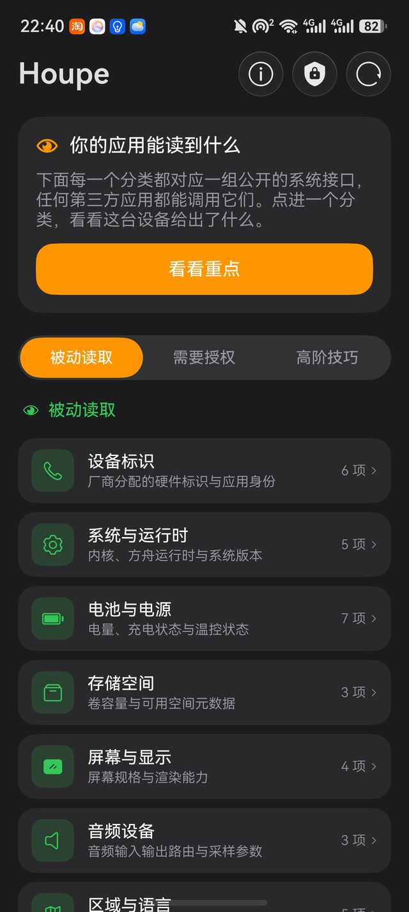
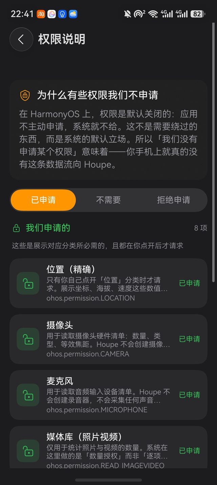

<p align="center">
  
</p>

# Houpe

Houpe 是一款 HarmonyOS（鸿蒙）应用，带你把「设备指纹」这件事亲手摸一遍。它从公开的系统 API —— 任何第三方应用都能调用的那些 —— 读取真实数值，并原样展示给你。目的很简单：看清你的设备在不经意间暴露了什么，以及每一项读数为什么能帮助一个应用再次认出你。

追踪者不需要你的名字、邮箱或位置，就能在网上认出你。单看任何一项读数都未必唯一，但它们组合起来，就是一枚跟着你穿越各个应用与网站的指纹。

<p align="center">
  
  
  
</p>

## 信号如何组织

Houpe 把每一项读数分成三档，对应获取它的权限：

- **被动读取** —— 任何应用无需任何提示就能读到：设备标识、系统与运行时、屏幕、电池、剪贴板、字体、图形能力……
- **需要授权** —— 会触发系统权限弹窗的读数：位置、摄像头、麦克风、媒体库、已安装应用探测。
- **高阶技巧** —— 对公开 API 的巧妙侧信道利用。目前包含网页视图指纹：在一个隐藏的本地网页里读取浏览器侧标识 —— Canvas 指纹（真实哈希）、WebGL 渲染器、UA 串、JS 视角的屏幕与时区，全程离线、不发起任何网络请求。

## 权限立场

在 HarmonyOS 上，权限默认是关闭的：应用不主动申请，系统就不给。这不是需要绕过的东西，而是系统的默认立场 —— 「我们没申请某个权限」意味着你手机上就真的没有这条数据流向 Houpe。

权限说明页列出 Houpe 对每一项权限的决策与理由：**已申请**（展示对应分类所必需，且在你点开后才请求）、**不需要**（用其他公开接口拿到了同样的信息）、**拒绝申请**（出于隐私边界，即使能申请也不要）。

## 隐私

Houpe 读到的一切都不会离开你的设备。全部采集在本机完成，**不发起任何网络请求**；数值原样展示，不做聚合，不上传、不同步、不共享。

## 多端与深色模式

- **多端部署**：适配手机、折叠屏、平板与 2in1 / PC。平板横屏与 PC 自动切换左右分栏导航；折叠屏开合、PC 自由窗口缩放实时响应。
- **深色模式**：跟随系统切换，全部配色提供深色资源变体。

## 与原版的差异

Houpe 是 [Loupe](https://github.com/mysk-research/loupe)（iOS，by mysk）的鸿蒙移植。原版的部分分类依赖 CoreTelephony、EventKit、iCloud 等 iOS 专属框架，鸿蒙没有等价 API。按「只保留鸿蒙上真实可读的分类」的原则，Houpe 收录 21 个分类 —— 首页出现的每一项，都是 HarmonyOS 上真能读到的值，而非占位演示。

## 构建

需要 DevEco Studio 6.1.1 或更新版本（兼容 SDK 6.1.0(23)，编译 SDK 26）。

1. 用 DevEco Studio 打开工程根目录。
2. 签名配置未随仓库发布（含本机凭据，已从 `build-profile.json5` 移除）。在 **File > Project Structure > Signing Configs** 中登录华为账号并自动生成本机签名，即可安装真机。
3. 也可以用命令行直接构建（产出未签名 HAP）：

```bash
cd <工程目录>
export PATH="/<DevEco Studio 安装目录>/jbr/bin:$PATH"
export DEVECO_SDK_HOME="/<DevEco Studio 安装目录>/sdk"
"<DevEco Studio 安装目录>/tools/node/node.exe" \
  "<DevEco Studio 安装目录>/tools/hvigor/bin/hvigorw.js" \
  --mode module -p product=default assembleHap --no-daemon
```

## 致谢

Houpe 的产品思路与分类框架来自 [mysk](https://mysk.co) 的 [Loupe](https://github.com/mysk-research/loupe) —— 一款出色的 iOS 隐私演示应用。如果你用 iPhone，去看看原版。与原版一样，Houpe 也几乎完全由 AI 编码工具协作完成。

## License

**源代码**以 [MIT License](LICENSE) 发布。

但以下内容**不在** MIT 授权范围内：

- **本项目的应用图标**（`AppScope/resources/base/media/app_icon.png`）：版权归本项目维护者© eDream0812所有，未经许可不得复制、修改、再分发或用于其他用途，详见 [NOTICE](NOTICE)；
- **Loupe 的名称、Logo 与设计文件**：© Mysk，保留所有权利。
